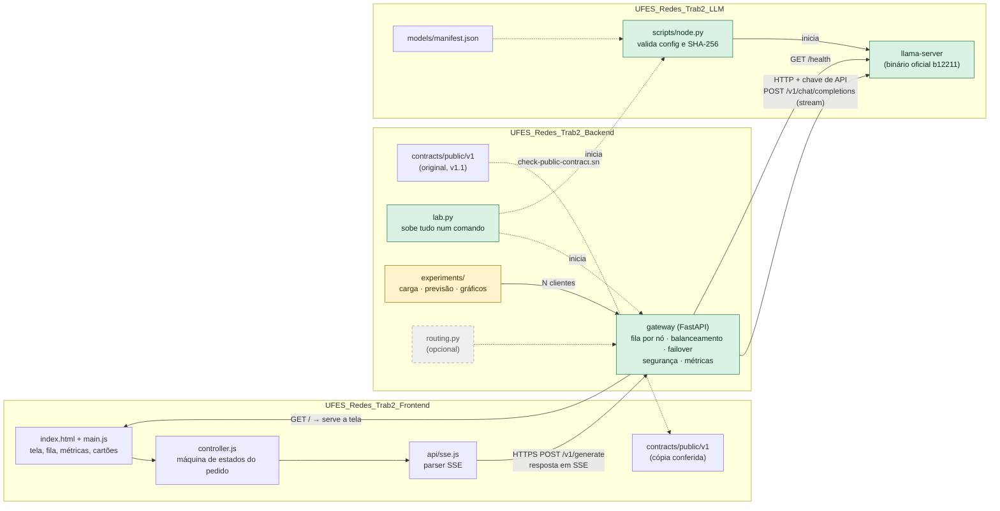
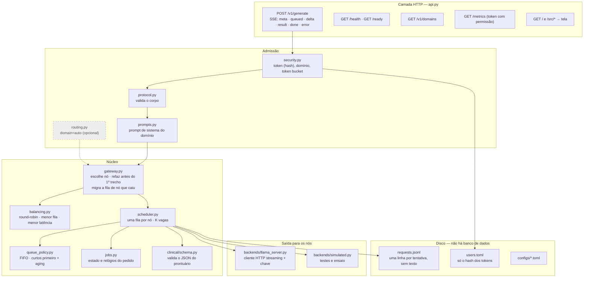
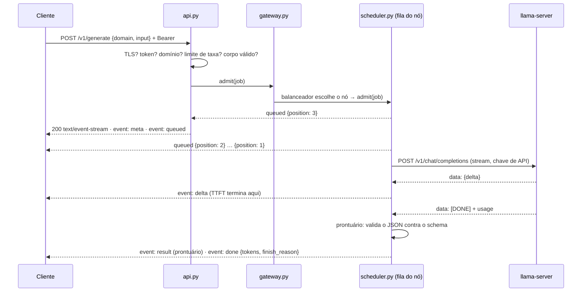
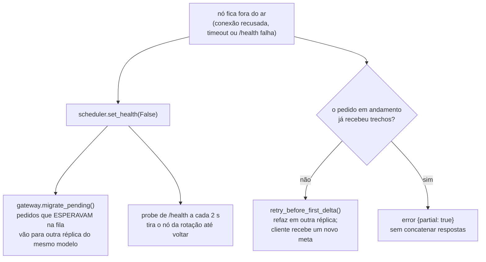

# Explicação do código — Backend

Este documento tem duas partes. A **Parte A** mostra, em diagramas, como as peças se encaixam: os três repositórios, as
camadas do gateway, o caminho de um pedido e onde cada processo roda. A **Parte B** explica o código arquivo por
arquivo. Os caminhos são relativos à raiz deste repositório.

As decisões por trás do desenho estão em [docs/PLANO.md](docs/PLANO.md), e as mudanças de 09/11 em
[docs/MUDANCAS.md](docs/MUDANCAS.md).

---

# Parte A — Diagramas

Os diagramas estão em Mermaid, que o GitHub e o VS Code desenham sozinhos. **Legenda:** verde = processo deste trabalho;
amarelo = ferramenta (navegador, medição); cinza tracejado = opcional ou desligado por padrão.

## A1. Os três repositórios e como conversam

**Quem é dono de quê:** o Backend é o único que decide fila, nó, retry e segurança do usuário. O nó LLM só gera texto e
não sabe de usuários. O Frontend só fala com a API pública.

## A2. Camadas do gateway (este repositório)

**Onde fica o estado:** em memória, num processo com um worker. A fila de cada nó é uma `deque` no `NodeScheduler`, e
cada pedido é um `Job` com uma `asyncio.Queue` de eventos que o `api.py` transforma em SSE. Reiniciar o gateway descarta
filas e limites de taxa.

## A3. Um pedido, passo a passo

## A4. O que acontece quando um nó cai

## A5. Onde cada processo roda

Os cinco cenários (uma máquina; gateway e LLM separados; N clientes; balanceamento; falha) estão desenhados em
[docs/PLANO.md, seção 3](docs/PLANO.md#3-o-que-roda-em-cada-máquina-os-cenários). O tutorial de cada um está em
[docs/LABORATORIO.md](docs/LABORATORIO.md).

## A6. Onde mexer para…

| Quero… | Arquivo |
|---|---|
| Trocar a política de fila | `queue_policy.py`; ativar em `[scheduling]` do TOML |
| Mudar o prompt ou os parâmetros de um domínio | `prompts.py` e `[domains.*]` do TOML |
| Mudar o JSON do prontuário | `clinical/schema.py` (o schema vai para o `llama-server` como `response_format`) |
| Criar uma política de balanceamento | `balancing.py` (`Balancer.order`) |
| Acrescentar um evento SSE | `scheduler.py` ou `api.py`, `contracts/public/v1/` e o `controller.js` do Frontend |
| Mudar o que vai para o log | `metrics.py` (`job_record`) — nunca texto do pedido |
| Mudar como o laboratório sobe tudo | `lab.py` |
| Mudar o experimento | `experiments/` |

## A7. Perguntas de entrevista (com a resposta curta)

| Pergunta | Resposta curta | Onde |
|---|---|---|
| Por que SSE e não WebSocket? | O fluxo é de mão única (servidor → cliente). O SSE é HTTP comum, atravessa proxy e o navegador já o entende. O cancelamento é fechar a conexão | `api.py`, `_event_stream` |
| Por que TCP e não UDP? | Um trecho perdido corrompe o texto ou o JSON. Atraso de alguns ms não atrapalha a leitura | — |
| Threads ou event loop? | Um event loop (asyncio) num worker. O gateway passa o tempo esperando rede; o trabalho pesado roda em outro processo, o `llama-server` | `api.py`, `cli.py` |
| O que acontece com 10 clientes e 1 vaga? | 1 é atendido, 9 esperam na `deque` do nó e recebem `queued {position}`. Acima de `max_inflight + max_queue`, a resposta é 503 | `scheduler.py` |
| Como garantem que o limite de vagas nunca é ultrapassado? | `admit` e `_dispatch_loop` contam e reservam sem `await` entre a conta e a reserva; no event loop, nada intercala | `scheduler.admit` |
| E se o cliente desconectar? | O `finally` do `_event_stream` cancela o pedido. Se o cancelamento chega antes de a tarefa começar, um callback libera a vaga (o bug achado no ensaio) | `scheduler._release_if_never_ran` |
| Nó cai antes, durante e depois de responder? | Na fila: migra. Antes do 1º trecho: refaz em outra réplica. Depois: `error partial=true` | diagrama A4 |
| Como medem TTFT? E por que trecho não é token? | TTFT = do envio ao 1º `delta`. Um `delta` é o pedaço que o runtime mandou e pode ter vários tokens; a contagem certa vem do `usage` do runtime, no `done` | `jobs.py`, `done.tokens_source` |
| Por que o TTFT dispara em N = K? | Lei de Little em laço fechado: com N > K, cada pedido espera (N/K − 1)·S na fila | `experiments/previsao.py` |
| Como funciona o limite de taxa? | Token bucket por usuário: enche `rpm/60` fichas por segundo até `burst`; cada pedido gasta uma; sem ficha, 429 com `Retry-After` | `security.TokenBucket` |
| O que o TLS protege e o que a chave protege? | TLS: o token e o conteúdo entre o navegador e o gateway. Chave: impede que outro aluno use o nosso nó na LAN | `docs/PLANO.md`, D4 |
| Por que o JSON do prontuário é sempre válido? | O `llama-server` gera restrito ao JSON Schema (`response_format`), e o gateway valida de novo com Pydantic antes do `result` | `llama_server._body`, `clinical/schema.py` |

---

# Parte B — O código, arquivo por arquivo

## B1. Fluxo

1. `cli.py` carrega e valida o TOML com `config.py` e inicia um único worker Uvicorn.
2. `api.py` autentica e admite `POST /v1/generate`, valida o corpo, resolve domínio e modelo e cria um `Job`.
3. `gateway.py` escolhe um nó compatível por `balancing.py`. Cada nó tem um `NodeScheduler` (`scheduler.py`), cuja
   fila segue a política de `queue_policy.py`.
4. O adapter (`backends/llama_server.py` ou `backends/simulated.py`) produz `Delta` e `Finish` conforme
   `backends/base.py`.
5. O scheduler valida o resultado, produz os eventos públicos e registra métricas. O `api.py` os converte em SSE; o
   `client.py` é um cliente de terminal de referência.

O gateway é o único dono de filas, concorrência, seleção de nós e failover. Os backends de inferência não tomam
decisões de roteamento.

## B2. Pacote `src/llm_gateway/`

### `__init__.py`

Declara a versão do pacote (`0.1.0`) e sua descrição curta; não inicializa serviços.

### `config.py` — configuração e validação

- `_Strict`: base Pydantic que proíbe chaves desconhecidas e congela os objetos validados.
- `GatewayConfig`: `frontend_dir` (pasta da tela que o gateway serve em `/`), limites de corpo/entrada/saída, deadlines, tempos de espera, health probes, buffer SSE, arquivos TLS, CA, CORS e limite do header de autenticação. Os validadores verificam origens CORS exatas, par cert/key, números finitos e coerência entre timeouts.
- `SecurityConfig`: habilitação de autenticação, arquivo de credenciais, exigência de TLS e campos de rate/burst para validação/defaults; o rate efetivamente aplicado a cada usuário vem do arquivo de credenciais.
- `RouterConfig`: ativa o classificador e define thresholds, seed e fração de avaliação.
- `BalancingConfig`: política permitida e máximo de tentativas de failover.
- `ModelConfig`: metadados do modelo, contexto e formato/hash SHA-256.
- `DomainConfig`: prompt, modelos permitidos, saída textual ou extração JSON, parâmetros de amostragem e limites de tokens; garante que prompt/schema/modelos e defaults sejam consistentes.
- `SimulationConfig`: atraso, velocidade, resposta, ponto de falha e `report_usage` (contagem de "tokens" simulados, para o ensaio do experimento); não representa inferência real.
- `NodeConfig`: identidade, URL, modelo, concorrência, limites de frame e saída, kwargs de template e `api_key_file` (a chave do `llama-server`). Valida URL, porta, credenciais e caminho. HTTP fora do loopback só com `api_key_file`.
- `SchedulingConfig`: política da fila (`fifo` ou `short_first`) e `aging_s`.
- `AppConfig`: valida as relações entre nós, modelos, domínios, roteador, simulação e trust bundle obrigatório para endpoints HTTPS.
- `load_config(path)`: lê TOML e devolve a configuração tipada ou falha antes de iniciar o serviço.

### `api.py` — HTTP, lifespan, admissão e SSE

- `_Reject`: carrega status HTTP, código/mensagem estáveis e headers adicionais para erros pré-stream.
- `_error_response(...)`: forma envelope JSON uniforme `{error: ...}`.
- `_read_limited(request, limit)`: consome o corpo em blocos e interrompe assim que excede o limite em bytes.
- `_event_stream(...)`: lê a fila de eventos do pedido, manda comentários keepalive e tenta failover só quando o erro é elegível e ainda não houve delta. Manda o `meta` antes do primeiro evento e **de novo** quando o pedido muda de nó antes do primeiro delta (o `attempt` aumenta). Encerra no primeiro `done` ou `error`. Se o cliente desconecta, pede o cancelamento do pedido.
- `create_app(config)`: constrói a aplicação FastAPI e seu ciclo de vida. No startup, cria o cliente HTTPX com verificação TLS/CA, os adapters, o `Gateway`, a segurança e (se ligado) o roteador, importado só nesse caso. Probes concorrentes consultam o `/health` de cada nó e mudam a saúde por `set_health`. No shutdown, cancela os probes e os schedulers e fecha logs e HTTP.
- `_on_reject`: converte exceções de admissão em respostas HTTP.
- `_principal`: limita o tamanho do Authorization antes do hash, autentica token e, para métricas, exige permissão específica.
- `GET /health`: liveness simples do processo.
- `GET /ready`: retorna 200 se algum scheduler está saudável, 503 caso contrário; não certifica, por si só, compatibilidade de hash/template/slots.
- `GET /v1/domains`: publica catálogo público dos domínios e formato de saída.
- `GET /metrics`: rejeita HTTP se TLS for obrigatório, verifica autorização e devolve snapshot de nós/roteador sem textos de entrada ou saída.
- `POST /v1/generate`: aplica TLS/auth/rate limit; inicia deadline no recebimento, limita leitura do corpo pelo menor tempo entre timeout configurado e prazo restante, valida DTO e limites; resolve somente `domain=auto` com o classificador; autoriza o domínio resolvido; monta mensagens de sistema; cria/admite `Job`; devolve erros HTTP distintos ou stream SSE com `X-Request-ID`.
- `GET /` e `/src/*`: com `gateway.frontend_dir`, servem a tela na mesma origem da API.
- `ClientDisconnect` na leitura do corpo vira 400 `client_disconnected`, sem exceção não tratada.
- `create_app_from_env()`: fábrica para Uvicorn que recupera o caminho TOML de `LLM_GATEWAY_CONFIG`.

### `jobs.py` — estado, falhas e relógios

- `JobState` e `TERMINAL_STATES`: estados não terminais/terminais da requisição.
- `RETRYABLE_CODES`: orientação pública para o cliente poder iniciar uma nova requisição; não autoriza automaticamente replay.
- `FAILOVER_CODES`: allowlist mais restrita, só para falhas transitórias entre gateway e nó.
- `JobError`: exceção com código e mensagem seguros para o protocolo.
- `_ms`: transforma dois tempos monotônicos em milissegundos ou devolve `None`.
- `Job`: mantém request ID, domínio/modelo, mensagens, orçamento, fila de eventos, deadline, tentativas, timestamps, contadores, token usage e task. Métodos calculam estado terminal, espera de fila, TTFT, serviço, E2E e taxa de decode apenas quando há usage e intervalo válidos.

### `gateway.py` — seleção, failover e migração da fila

- `NoHealthyNodes`: não existe nó saudável para a seleção pedida.
- `Gateway.__init__`: cria um `NodeScheduler` por nó, com a política de fila do `[scheduling]`, a lista de nós de cada
  domínio e o balanceador. Liga o callback `on_unhealthy` de cada scheduler ao `migrate_pending`.
- `start()` / `stop()`: inicia e encerra os dispatchers e fecha o log.
- `admit(job)`: filtra nós saudáveis do modelo pedido e tenta admitir na ordem do balanceador; distingue "nenhum nó
  saudável" (503 `no_healthy_nodes`) de "todos cheios" (503 `queue_full`).
- `retry_before_first_delta(job)`: depois que a tentativa anterior terminou, exige zero trechos, código transitório,
  prazo válido e limite de tentativas; escolhe outra réplica do mesmo modelo. **Limpa os eventos da tentativa anterior
  antes de admitir**, porque a admissão já publica o `queued` da nova tentativa.
- `migrate_pending(failed)`: chamado quando um nó fica fora do ar. Leva cada pedido que **esperava** na fila dele para
  uma réplica saudável do mesmo modelo que tenha espaço. Se nenhuma aceitar, o pedido fica e espera o nó voltar.
- `cancel(job, reason)`: delega o cancelamento ao scheduler dono do pedido.
- `snapshot()`: políticas, domínios, vazão total e o estado de cada nó.

### `scheduler.py` — a fila de cada nó

- `Overloaded`: fila e vagas esgotadas (503).
- `NodeScheduler.__init__`: backend, configuração, estatísticas, a fila (`deque`), os ativos, a saúde, a política de
  fila e o callback `on_unhealthy`. Nós simulados começam saudáveis; nós reais esperam o primeiro probe.
- `set_health(healthy, reason)`: **único ponto** que muda a saúde. Na transição para fora do ar, chama
  `on_unhealthy` (o gateway migra a fila); ao voltar, acorda o dispatcher.
- `pending_jobs()` / `remove_pending(job)`: a fila na ordem da política, e a retirada sem encerrar (usada na migração).
- `_publish_positions()`: manda `queued {position, node}` a cada pedido cuja posição mudou. É informativo: com o
  buffer do cliente cheio, a atualização é pulada.
- `admit(job)`: reserva a vaga sem `await` entre a conta e a reserva; atribui nó, modelo e tentativa; publica as
  posições; rejeita acima de `max_inflight + max_queue`.
- `cancel(job, reason)`: tira da fila (e republica as posições) ou cancela a tarefa ativa.
- `_dispatch_loop()`: acorda a cada mudança ou a cada 0,5 s; expira vencidos; não despacha em nó fora do ar; enquanto
  houver vaga, pega o **próximo segundo a política** e inicia.
- `_expire_pending()`: tira os vencidos (prazo total ou `queue_timeout_s`), manda o erro terminal e republica as posições.
- `_start(job)`: marca ACTIVE, cria a tarefa e registra o callback `_release_if_never_ran`.
- `_release_if_never_ran(job)`: se o pedido foi cancelado antes de a tarefa dar o primeiro passo, o asyncio descarta
  a corrotina sem rodar o `try/finally` de `_run`; este callback libera a vaga nesse caso. Foi o bug da vaga presa,
  achado no ensaio do experimento.
- `_run(job)`: aplica o prazo total, classifica erro, timeout e cancelamento, libera a vaga e registra as métricas,
  incluindo os tokens para a vazão.
- `_stream(job)`: consome `Delta` e `Finish`; limita os bytes de saída; conta trechos e tempos; publica os deltas.
  Aceita `finish` `stop`, e também `length` em texto (resposta cortada no limite de tokens); JSON cortado é erro
  `truncated`. Valida o prontuário e reserva espaço para `result` + `done`. A transição para DONE e os eventos
  terminais acontecem sem `await` entre eles.
- `_emit(...)`: coloca o delta com o timeout de cliente lento.
- `_fail(...)`: marca a falha; em falha transitória, tira o nó do ar via `set_health`; garante o evento `error`
  mesmo com o buffer cheio.
- `snapshot()`: saúde, vagas, fila, política, contadores, vazão e `active_jobs` (os pedidos ocupando vaga, sem texto).

### `queue_policy.py` — a ordem da fila

- `QueuePolicy("fifo")`: ordem de chegada.
- `QueuePolicy("short_first", aging_s)`: menor `max_output_tokens` primeiro. Quem espera mais que `aging_s` vai para
  a frente, em ordem de chegada (envelhecimento), para que um pedido longo não espere para sempre.
- `ordered(pending, now)` / `next_job(...)`: funções puras, fáceis de testar. O scheduler continua dono da fila.

### `balancing.py` — ordenação de candidatos

- `Balancer(policy)`: `round_robin`, `least_loaded` ou `least_latency`, com um cursor por domínio.
- `order(domain, candidates)`:
  - **round-robin** gira o primeiro escolhido;
  - **menor fila** ordena por pedidos no nó (ativos + na fila);
  - **menor latência** (`_least_latency`) ordena pela espera prevista = (pedidos no nó + 1) × EWMA do tempo de
    serviço. Nó sem medição vem primeiro (aquecimento). A cada `EXPLORE_EVERY` (20) decisões, o nó há mais tempo sem
    ser o primeiro passa à frente uma vez, para voltar a ser medido.

### `metrics.py` — estatísticas e JSONL

- `EWMA_ALPHA`: peso da observação nova na média móvel exponencial.
- `THROUGHPUT_WINDOW_S`: janela da vazão agregada (60 s).
- `NodeStats`: contadores (concluídos, falhas, cancelados, expirados, rejeitados), o EWMA do serviço e a vazão:
  `observe_completion(tokens)` registra cada pedido concluído e `throughput()` devolve pedidos/s e tokens/s na janela.
- `RequestLog`: arquivo JSONL opcional, um registro por tentativa.
- `job_record(job)`: estados, identificadores, tempos e contagens, sem prompt, entrada, saída ou token.

### `protocol.py` — DTO e SSE

- `TERMINAL_EVENTS`: `done` e `error`.
- `GenerateRequest`: valida domínio/entrada e aceita `max_output_tokens` como inteiro estrito positivo, sem coerção de string/bool.
- `sse_encode(event, data)`: serializa JSON compacto Unicode em formato SSE com linha em branco terminal.
- `sse_comment(text)`: codifica comentário/heartbeat, que não é delta.
- `iter_sse(lines)`: parser síncrono de linhas para o cliente Python; agrega múltiplas linhas `data`, ignora comentários e não emite frame incompleto no EOF.

### `prompts.py` — prompts imutáveis por versão

- `REDES_V1` e `PRONTUARIO_V1`: instruções server-side para os dois domínios; o usuário não pode substituí-las.
- `PROMPTS`: catálogo nomeado.
- `prompt_hash(name)`: hash da versão usada para identificação/auditoria.
- `build_messages(prompt, output, user_input)`: cria mensagens system/user e delimita documento como entrada não confiável; para extração pede JSON.

### `routing.py` — classificador do modo automático (opcional, desligado por padrão)

Só é importado com `[router] enabled = true`, e precisa do extra `pip install -e .[router]` (scikit-learn e NumPy). É o piloto da trilha Inteligência: 120 frases sintéticas. A acurácia dele não representa generalização.

- `RoutingDataError`, `RouteUncertain`: erros de dataset inválido e confiança insuficiente; a incerteza inclui candidatos/probabilidades.
- `RouteDecision`: domínio/modelo escolhido, confiança e classe de complexidade.
- `_pipeline(seed)`: cria pipeline TF-IDF + regressão logística com seed fixa.
- `load_examples(path, known_domains)`: lê JSONL sintético, valida campos/IDs/domínios/complexidades/grupos e separa grupos para evitar vazamento por grupo.
- `SemanticRouter.__init__`: carrega dados, treina no subconjunto de treino e calcula avaliação holdout; isso ocorre ao iniciar quando router está habilitado.
- `_evaluate(...)` / `evaluation()`: calcula acurácia/matriz e publica resumo sem conteúdo dos exemplos.
- `_top(...)`: ordena probabilidades e devolve candidatos principais.
- `route(requested_domain, text)`: combina confiança de domínio e complexidade, aplica thresholds sem arredondar internamente, e resolve modelo permitido pelo domínio; domínio explícito não passa por esta seleção automática.

### `security.py` — Bearer, autorização e rate limit

- `CredentialError`, `RateLimitExceeded`: erros de carregamento e limite, este último com `Retry-After`.
- `UserCredential`, `CredentialFile`: schemas estritos; guarda hash do bearer, domínios permitidos, rate/burst e permissão de métricas.
- `Principal`: identidade autenticada e pseudônimo de auditoria.
- `load_credentials(...)`: lê TOML, valida usuários, hashes únicos e domínios conhecidos; falha fechada.
- `TokenBucket`: bucket por usuário com recarga baseada em monotonic clock.
- `SecurityManager`: compara hash do token em tempo constante, autoriza domínio, aplica rate e decide acesso a métricas.
- `token_digest()` / `new_token()`: derivam SHA-256 e criam segredo opaco de alta entropia.
- `write_credential_file(...)`: valida parâmetros e username, atualiza usuário sem overwrite implícito e escreve TOML atomicamente com permissão restrita.

## B3. Backends de inferência

### `backends/base.py`

Define os tipos imutáveis `Delta(text)` e `Finish(reason, usage)` e o protocolo `Backend.stream(job)`. O scheduler depende deste contrato, não da implementação concreta.

### `backends/__init__.py`

Exporta tipos e `make_backend(node, client)`, que seleciona adapter llama-server ou simulado pela configuração.

### `backends/llama_server.py`

- `LlamaServerBackend.__init__`: monta o endpoint `/v1/chat/completions`, guarda o cliente HTTPX compartilhado e, com `api_key_file`, lê a chave do nó, que vai em todo pedido como `Authorization: Bearer`. Um 401 do nó vira erro claro ("recusou a chave de API").
- `_body(job)`: monta mensagens, stream, usage, limite de tokens, sampling e, para schema clínico, `response_format` com JSON Schema.
- `stream(job)`: abre POST streaming, distingue status HTTP, lê eventos do protocolo OpenAI-like, valida tipos/finish/usage/`[DONE]`, emite `Delta`, mapeia falhas HTTP/timeout/protocolo para `JobError` e termina com `Finish`. Uma falha de conexão/transporte pode ser elegível para failover; payload/schema inválidos não devem ser reproduzidos automaticamente.

### `backends/simulated.py`

- `SimulatedBackend.__init__`: divide resposta de fixture em fragmentos semelhantes a palavras.
- `stream(job)`: espera o startup (se configurado), emite fragmentos no ritmo configurado e corta em `max_output_tokens` com `Finish("length")`, como o `llama-server`. Pode falhar num índice determinístico. Com `report_usage`, informa a contagem de fragmentos como tokens. Serve para regressões e para o ensaio do experimento, nunca como medição de LLM.

## B4. Extração clínica

### `clinical/__init__.py`

Reexporta o schema e helpers para que API/scheduler importem de um ponto estável.

### `clinical/schema.py`

- `Medicamento`: nome, dose, via e frequência, cada qual explicitamente presente ou `null`; chaves extras são proibidas.
- `SinaisVitais`: valores em texto para manter unidade/fidelidade da fonte.
- `ProntuarioV1`: contrato clínico v1, campos estritos e limites documentados; idade usa `StrictInt` quando informada.
- `SCHEMAS`: mapa de versão.
- `json_schema_for(name)`: exporta schema para constrained decoding no runtime.
- `validate_output(name, text)`: parseia JSON e valida a estrutura completa antes de qualquer evento público `result`.

## B5. CLI e scripts do Backend

### `cli.py`

- `_cmd_serve`: valida config e cert/key quando TLS obrigatório, fixa caminho de config no ambiente e inicia um worker Uvicorn com interpretação de proxy headers desativada.
- `_cmd_check`: carrega config, mostra relações domínio/modelo/nó, valida credenciais/roteador e informa problemas sem iniciar gateway.
- `_cmd_token_create`: cria token e grava somente seu hash; o segredo é exibido para provisionamento.
- `main(argv)`: define subcomandos, argumentos e despacho para o handler.

### `client.py`

- `run_request(...)`: POST síncrono HTTPX, opção CA/Bearer, lê SSE incremental, imprime texto se solicitado, mede tempos locais e produz relatório estruturado. Requer terminal coerente; não transforma erro/parcial em resposta concluída.
- `main(argv)`: valida flags de domínio/arquivo/token/URL, lê entrada e configura saída textual/JSON.

### `scripts/build_routing_dataset.py`

- Constantes de temas e templates criam exemplos sintéticos variados para Redes e extração clínica, em classes simples/complexas.
- `build()`: percorre temas/templates, atribui IDs e grupos por tópico, sinaliza `synthetic=true` e embaralha com seed fixa.
- Bloco principal grava JSONL em `data/routing_examples.jsonl`. O dataset é piloto autoral por templates; não representa holdout independente de linguagem natural.

### `scripts/generate-local-ca.sh`

Valida SANs/duração, usa lock para evitar duas execuções simultâneas, recusa sobrescrever arquivos existentes, gera em diretório temporário uma CA local e certificado TLS do gateway, atribui permissões diferentes a chaves/certificados e só então move os arquivos finais. É para ambiente local, não uma PKI remota.

### `scripts/check-public-contract.sh`

Resolve a raiz Backend e compara byte a byte `contracts/public/v1/events.json` com a cópia do Frontend por `cmp`.

## B6. Contrato, configurações e testes

- `contracts/public/v1/events.json`: schemas JSON dos payloads `meta`, `queued`, `delta`, `result`, `done` e `error` (v1.1).
- `contracts/public/v1/README.md`: a ordem dos eventos, os terminais e o histórico de versões.
- `configs/cpu_minimal.toml`: dois modelos/domínios, HTTP interno em loopback e sem auth/TLS para desenvolvimento controlado.
- `configs/m2_secure.toml`: TLS cliente-gateway, bearer/autorização/rate, roteador desligado e nós HTTPS sem réplica de Redes.
- `configs/experiment_simulated.toml`: ensaio do experimento sem modelo (backend simulado, timeouts longos).
- `configs/m2_replicas.toml`: perfil seguro com segunda réplica equivalente do modelo pequeno; implica recursos adicionais.
- `tests/conftest.py`: configuração simulada reutilizável, server Uvicorn em thread e fixture HTTP real local.
- `test_config.py`: schemas, referências, limites, perfis e rejeição de URL/config insegura.
- `test_api_sse.py`: rotas, CORS, stream progressivo, extração, fila, cancelamento, falhas e health.
- `test_scheduler.py`: FIFO, limite de concorrência, expiração, cancelamento, parcial, buffers e cliente lento.
- `test_failover.py`: failover em fixture, sem concatenar respostas, erros não elegíveis e deadline.
- `test_llama_backend.py`: contrato HTTP/SSE interno via transporte simulado e erros de protocolo/transporte.
- `test_balancing.py`: ordem das três políticas e fallback de admissão quando a primeira fila enche.
- `test_routing.py`: split/grupos, holdout, confiança, modelo escolhido e integração API.
- `test_security.py`: hash/permissão de credenciais, autenticação, autorização, rate limit, TLS local e exposição de métricas.
- `test_protocol_and_clinical.py`: SSE, DTO estrito e validação JSON clínica.
- `test_plano_v2.py`: as mudanças de 09/11 (política de fila, `queued`, migração, menor latência, vazão, tela servida pelo gateway, texto cortado em `length`, vaga presa). O roteador é pulado sem o extra `[router]`.

Os testes simulados/HTTP/TLS local não equivalem a benchmark nem provam inferência real.

## B7. `lab.py` — o lançador do laboratório

Roda com o Python da máquina (3.8+), **antes** de existir o `.venv`. Por isso não importa nada do pacote.

| Função | O que faz |
|---|---|
| `garantir_python` | Cria o `.venv`. Usa o `venv` nativo se o Python for 3.12+ e tiver `ensurepip`; senão baixa o `uv`, que traz o Python 3.12 |
| `baixar` | Baixa ou copia do cache (pendrive) e **sempre** confere o SHA-256 antes de usar |
| `garantir_llama` / `garantir_modelo` | `llama-server` oficial fixado em `LLAMA_VERSAO`; modelos do `models/manifest.json` do repo LLM |
| `garantir_chave` / `garantir_token` / `garantir_tls` | Chave dos nós, token do usuário `lab` (por `llm-gateway token-create`) e certificado do gateway (por `scripts/generate-local-ca.sh`) |
| `config_no` / `config_gateway` | Geram `.lab/nos/*.toml` e `.lab/gateway.toml` com caminhos absolutos |
| `iniciar` / `esperar_http` / `parar_tudo` | Sobem os processos, esperam o `/health`, e com Ctrl+C encerram os filhos |
| `cmd_demo`, `cmd_no`, `cmd_gateway` | Cenários 1 a 5 de `docs/PLANO.md` |
| `cmd_experimento` | Para cada K: sobe a pilha, calibra, grava a previsão, roda N × repetições; depois o desafio; depois os gráficos |
| `cmd_baixar`, `cmd_pacote` | Cache para o pendrive; zip dos 3 repositórios (`git archive`) com a chave do grupo |

## B8. `experiments/` — o experimento

- `carga.py`: N clientes em laço fechado (`asyncio` + `httpx`), lendo o SSE como o navegador faria; uma linha de CSV
  por pedido; ao atingir a meta de pedidos, cancela os que estão em andamento (o gateway os libera).
- `previsao.py`: calibração com N = K → *T0* e *S* → TTFT previsto = (N/K − 1)·S + T0 para N > K; grava
  `previsao-k*.json`.
- `graficos.py`: média por repetição e IC 95% (t de Student, sem scipy), p95, curva prevista, box plot do desafio,
  `resumo.md`.
- `perguntas.txt`: 20 perguntas longas para que todos os pedidos tenham o mesmo tamanho.
