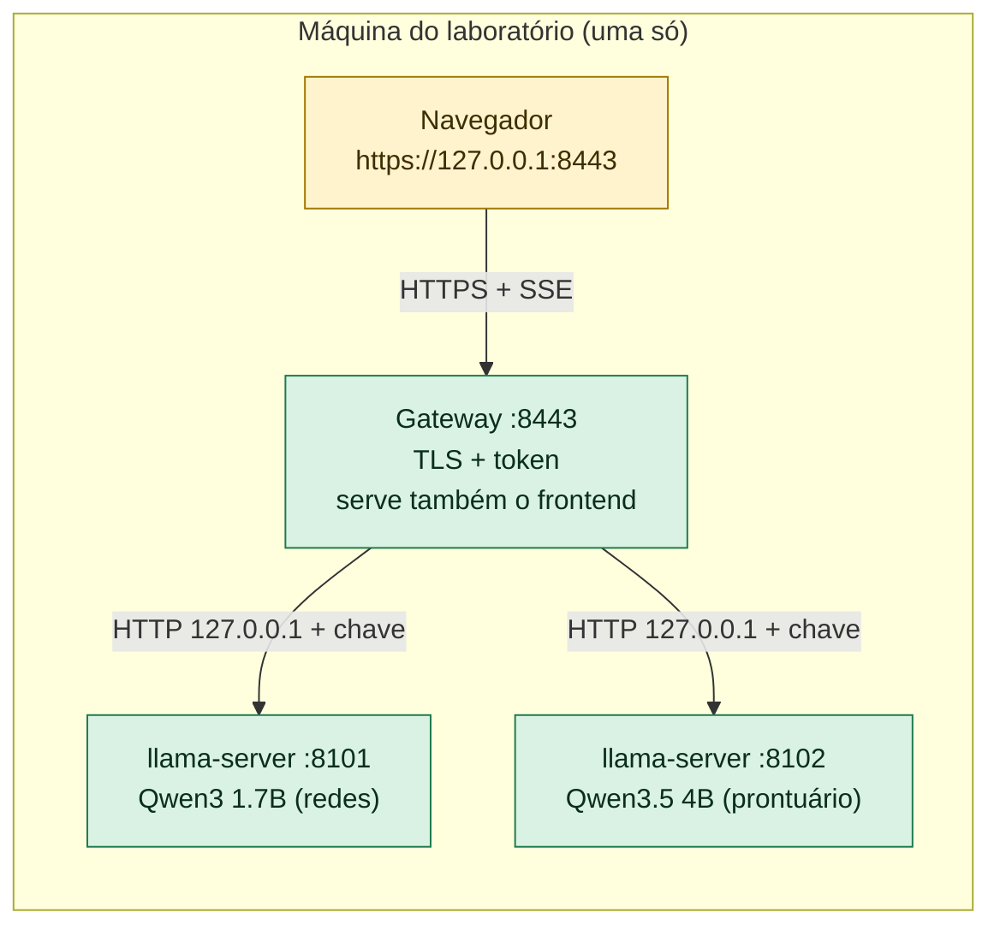
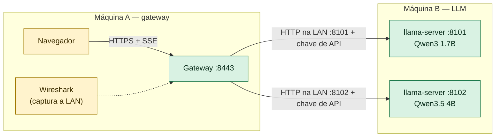
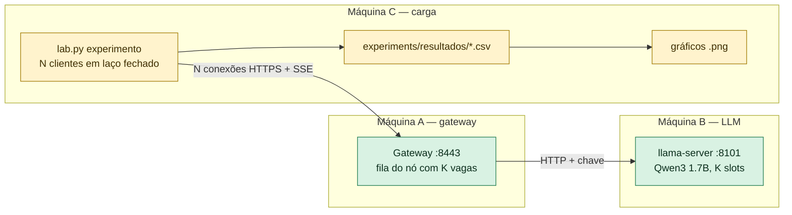
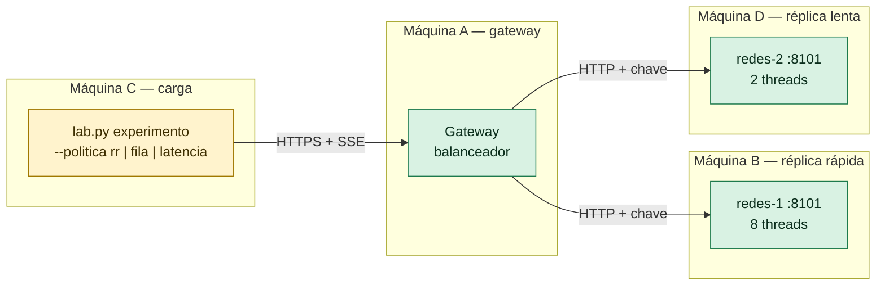
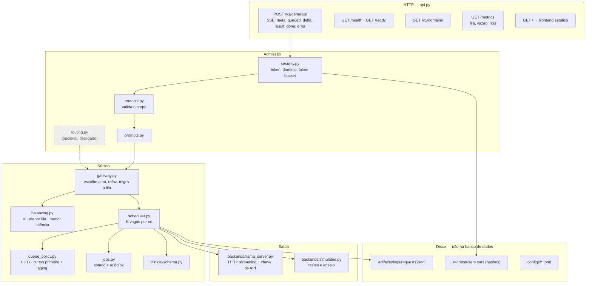
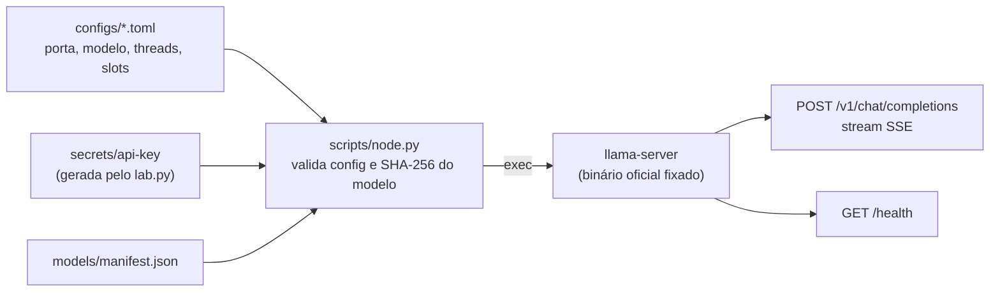
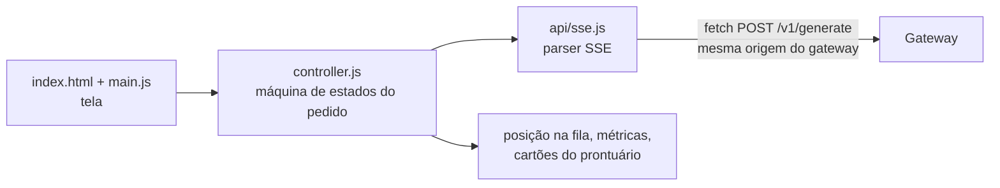

# Plano de implementação do T2 — versão 2 (09/11/2026)

**Para quem é este documento:** Daniel, Lívia e Eduardo. Ele explica **o que mudou nos três repositórios, por que mudou
e como conferir**, para que ninguém seja pego de surpresa por uma mudança que não fez. O resumo das mudanças, arquivo por
arquivo, está em [MUDANCAS.md](MUDANCAS.md). O tutorial do laboratório está em [LABORATORIO.md](LABORATORIO.md).

**Ponto de partida.** A revisão de 09/11 sobre o estado de 02/11 apontou quatro coisas:
- **O que falta vale 35% da nota:** o experimento obrigatório e a pergunta-desafio não tinham começado.
- **10 testes falhavam no Windows.**
- **Rodar o projeto exigia Nix.**
- **A topologia não saía de uma máquina:** os nós ouviam só em `127.0.0.1`.

**Como desfazer qualquer coisa.** O estado anterior a este plano está marcado com a tag **`antes-do-plano-v2`** nos três
repositórios. Para comparar: `git diff antes-do-plano-v2 -- caminho/do/arquivo`.

---

## 1. Requisitos da spec e onde cada um é atendido

**Prazo: 22/11/2026** (confirmado pela equipe em 09/11; as datas de 26/10 e 08/11 dos documentos anteriores estão
erradas).

**Como a nota é dada.** As instruções de entrega ([INSTRUCOES-ENTREGA.pdf](INSTRUCOES-ENTREGA.pdf)) trazem esta tabela,
que pesa diferente da tabela da spec:

| Critério (instruções de entrega) | Pontos | O que o plano faz por ele |
|---|---|---|
| Atendimento aos requisitos do desafio | 10 | Tabela abaixo |
| Qualidade do código (estrutura e boas práticas) | 20 | Testes, CI, lint, README no formato pedido |
| **Conhecimento sobre o código** | **40** | Simplificações (seção 2), `EXPLICACAO.md` com diagramas, perguntas de entrevista (seção 7) |
| Tratamento de erros e exceções | 10 | Relatório, seção 4 |
| Testes de desempenho e estabilidade | 10 | Experimento reduzido (3 repetições) e suíte no CI |
| Inovação e incrementos implementados | 10 | Fila com posição, migração da fila, `lab.py` |

A tabela da spec (núcleo 30%, incrementos 25%, experimento 25%, desafio 10%, código 10%, bônus até 10%) continua
valendo como lista do que fazer. Pela tabela das instruções, **entender o próprio código vale mais que qualquer
funcionalidade nova**: na dúvida, simplificar.

| Requisito | Onde está | Situação depois do plano |
|---|---|---|
| Protocolo com resposta token a token | `api.py` (`POST /v1/generate`, SSE) | Feito; o evento `queued` foi acrescentado (contrato v1.1) |
| Dois domínios com modelo, prompt e parâmetros próprios | `configs/*.toml`, `prompts.py` | Feito (`redes`, `prontuario`) |
| Fila por nó com limite de concorrência | `scheduler.py`, `queue_policy.py` | Feito, com FIFO e "curtos primeiro com envelhecimento" |
| Métricas: TTFT, tokens/s, latência fim a fim, vazão | `jobs.py`, `metrics.py`, `GET /metrics` | Feito; a vazão agregada foi acrescentada |
| Desempenho: 3 políticas de balanceamento, failover | `balancing.py`, `gateway.py` | Feito; "menor latência" foi corrigida e os pedidos presos num nó que caiu passam a migrar |
| Segurança: token, domínio, limite de taxa, TLS | `security.py`, `cli.py` | Feito; o bug do Windows foi corrigido; chave de API entre gateway e nós |
| Inteligência: roteamento semântico | `routing.py` | Mantido como **opcional e desligado** (decisão D3) |
| Experimento: N = 1…16, previsão antes, repetições, gráficos | `experiments/` | Ferramentas prontas e testadas em modo simulado; **a medição real roda no laboratório** |
| Pergunta-desafio | `experiments/`, política de fila | Ferramentas prontas; **a medição real roda no laboratório** |
| Relatório breve (instruções de entrega) | `docs/RELATORIO.md` | Pronto, com a medição do laboratório (19/11) |
| README reproduzível e demonstração | `README.md`, `lab.py`, `docs/LABORATORIO.md` | Um comando: `python3 lab.py demo` |

---

## 2. Decisões técnicas

"Entrevista ↓" quer dizer que a escolha deixa o sistema mais fácil de explicar.

| # | Decisão | Antes | Escolha | Por quê | Entrevista |
|---|---|---|---|---|---|
| D0 | Prazo | 26/10 (errado) | **22/11/2026** | Confirmado pela equipe em 09/11; cabe a medição real com 3 repetições | — |
| D1 | Repositórios | 3 | **Manter os 3** | Fronteiras claras, um dono por repo | = |
| D2 | Ambiente | Nix obrigatório | **`lab.py`**: cria o venv sozinho (usa o `uv` se o Python da máquina for anterior ao 3.12), baixa o `llama-server` oficial e os modelos com SHA-256 conferido. O Nix continua como alternativa | Roda igual em qualquer Linux do laboratório, sem instalar nada no sistema | ↓↓ |
| D3 | Roteador semântico | Ligado no perfil M2; scikit-learn obrigatório | **Opcional e desligado.** O scikit-learn virou dependência opcional (`pip install -e .[router]`) | A spec pede duas trilhas, e Desempenho + Segurança cobrem isso. O código fica, sem pesar na instalação, caso o professor peça uma terceira trilha para o trio | ↓ |
| D4 | Segurança entre gateway e nós | HTTPS com CA própria por nó | **HTTP na rede do laboratório com chave de API** (`llama-server --api-key-file`). O HTTPS por nó continua possível, mas fora do caminho padrão | O TLS que a spec pede está entre o cliente e o gateway. A chave impede que um colega do laboratório use o seu nó, sem a montagem de certificados por máquina | ↓↓ |
| D5 | Onde os nós rodam | Mesmo host, `127.0.0.1` | **Cenários da seção 3**: tudo numa máquina para a demonstração; máquinas separadas para balanceamento e failover | Réplicas no mesmo host não somam capacidade | = |
| D6 | Domínio do experimento | — | **`redes`, `max_tokens = 128`, temperatura 0** | O prontuário levou ~68 s por pedido no smoke | — |
| D7 | Vagas por nó (K) | 1 | **Medir K = 1 e K = 2** | Com K = 1 o gráfico fica trivial | = |
| D8 | Timeouts do experimento | fila 120 s | **Perfil próprio: fila 900 s, prazo 1200 s** | Com 120 s, o experimento mediria só timeouts | — |
| D9 | Falha no meio da resposta | Erro parcial | **Mantido**, e agora medido | Continuar a resposta em outro nó não funciona com JSON forçado e é difícil de defender | ↓ |
| D10 | Pedidos na fila de um nó que caiu | Ficavam presos | **Migram para outra réplica** | Failover de verdade, com teste | = |
| D11 | "Menor latência" | EWMA do tempo total; ignorava a fila | **Espera prevista = (pedidos no nó + 1) × EWMA do tempo por pedido**, e reamostragem do nó preterido a cada 20 escolhas | Considera a fila e não abandona um nó para sempre | = |
| D12 | Política de fila | Só FIFO | **FIFO ou curtos primeiro com envelhecimento** (`[scheduling]` no TOML) | Necessária para a pergunta-desafio | = |
| D13 | Cliente vê a fila | Só `keepalive` | **`meta` na admissão + evento `queued {position}`** | É o dado central da pergunta-desafio | = |
| D14 | FHIR | Não existe | **Fora deste plano.** Fica como trabalho futuro no relatório | A spec não pede FHIR | = |
| D15 | Avaliação com o AnonyMED-BR | Planejada | **Cortada do T2** | Licença pendente, e a spec não pede | ↓ |
| D16 | Frontend | Tela mínima | **JS puro**, com posição na fila, painel de métricas e resultado em cartões. **Servido pelo próprio gateway** (mesma origem, sem CORS) | Um processo a menos para subir no laboratório | ↓ |
| D17 | Documentação | README de 240 linhas e três planos | **README curto, `docs/` organizado, planos antigos em `docs/historico/`** | O professor lê o README primeiro | ↓ |
| D18 | Autoria dos commits | `Your Name` | **Cada um configura `git config user.name/user.email`** | Mostra quem fez o quê | — |
| D19 | Bônus de integração | — | **Só depois do M3** | Não compensa atrasar o experimento | — |

---

## 3. O que roda em cada máquina: os cenários

**Legenda:** caixa verde = processo deste trabalho; caixa amarela = ferramenta de medição; seta = conexão de rede
(protocolo e porta). **Não existe banco de dados:** o gateway guarda fila e estado em memória e escreve só o log JSONL.

### Cenário 1 — Demonstração numa máquina só

Para apresentar o sistema, os dois domínios, a fila e a segurança. Um comando: `python3 lab.py demo`.



- **Ocupação:** ~6,3 GiB de RAM com os dois modelos. Numa máquina com 8 GiB, use `python3 lab.py demo --leve`, em
  que o modelo pequeno atende os dois domínios (~2 GiB).
- **Segurança:** os nós ouvem só em `127.0.0.1`. O gateway ouve em `127.0.0.1`, com TLS e token. Nada fica exposto na
  rede do laboratório.

### Cenário 2 — Gateway e LLM em máquinas separadas

Para mostrar que o sistema é distribuído e medir o custo da rede no TTFT, comparando com o cenário 1.



| Comparação | Cenário 1 (juntos) | Cenário 2 (separados) |
|---|---|---|
| Caminho gateway → nó | loopback, sem rede | LAN do laboratório |
| O que muda no TTFT | só o prefill do modelo | prefill + RTT da LAN + abertura de conexão |
| CPU disputada | gateway e modelos na mesma máquina | o modelo tem a máquina B só para ele |
| O que mostrar no Wireshark | nada (loopback) | o handshake TCP, o POST e os trechos SSE do nó |

### Cenário 3 — N clientes simultâneos (experimento obrigatório)

Para o experimento da spec: N = 1, 2, 4, 8 e 16 clientes em laço fechado. O gerador de carga fica numa **máquina
própria**, para não disputar CPU com o modelo.



**Previsão, feita antes de medir.**
- **Calibração:** com N = 1, mede-se *T₀*, o TTFT sem fila, e *S*, o tempo de serviço de um pedido.
- **Lei de Little:** com K vagas, a vazão máxima é *X = K/S* e o tempo de resposta é *R = N/X*.
- **Daí:** para N > K, **TTFT ≈ (N/K − 1)·S + T₀**. Para N ≤ K, TTFT ≈ T₀.

O comando `python3 lab.py experimento --prever` calcula e grava essa previsão em `experiments/previsao.json` antes de
qualquer medição.

### Cenário 4 — Balanceamento entre réplicas

Para comparar round-robin, menor fila e menor latência. As duas réplicas ficam em máquinas diferentes. Uma delas fica
mais lenta de propósito, com menos threads, para que as políticas se diferenciem.



### Cenário 5 — Falha de um nó

É o cenário 4 com o processo da máquina D derrubado no meio da carga (`Ctrl+C` no terminal dela). O que se mede:

| O que acontece | Para quais pedidos | Como aparece |
|---|---|---|
| Migra para a máquina B | Pedidos que estavam **na fila** da máquina D | Terminam normalmente; `meta.attempt_nodes` lista os dois nós |
| Refeito na máquina B | Pedidos que estavam no nó, **antes do primeiro trecho** | Terminam normalmente, com `attempt = 2` |
| Erro parcial | Pedidos que **já tinham recebido trechos** | `error` com `partial=true`, sem `done` |
| Fora da rotação | Máquina D | O gateway a tira do balanceamento até o `/health` voltar |

---

## 4. Camadas de cada repositório

### Backend



### LLM



### Frontend



---

## 5. Tutorial do laboratório (resumo)

O passo a passo completo, com solução de problemas, está em [LABORATORIO.md](LABORATORIO.md).

**Antes, em casa (uma vez, numa máquina com acesso aos repositórios):**

```bash
python3 lab.py pacote                # gera t2-lab.zip com os 3 repos e UMA chave: mande o MESMO zip aos 3 por e-mail
python3 lab.py baixar --destino /media/pendrive/t2-cache   # binário + modelos, com SHA-256 conferido
```

**No laboratório (em cada máquina):**

```bash
unzip t2-lab.zip && cd t2-lab/UFES_Redes_Trab2_Backend
python3 lab.py demo                  # cenário 1: instala, sobe os nós e o gateway, imprime a URL e o token
```

- **Sem credencial do GitHub no laboratório:** o pacote não precisa de `git clone` de repositório privado.
- **Sem instalar nada no sistema:** tudo fica dentro da pasta `t2-lab/` e é apagado com `rm -rf t2-lab`.
- **Mesmas versões em todas as máquinas:** binário, modelos e código são fixados por hash.

---

## 6. Como a equipe acompanha as mudanças

| Onde | O que tem |
|---|---|
| [MUDANCAS.md](MUDANCAS.md) | Cada mudança: o que era, o que ficou, por quê, arquivos e teste que prova |
| `CHANGELOG.md` de cada repo | Uma linha por mudança, com data |
| Tag `antes-do-plano-v2` | O estado anterior, para comparar ou desfazer |
| Commits | Um commit por assunto, com mensagem descritiva |
| [EXPLICACAO.md](../EXPLICACAO.md) de cada repo | Diagramas e o código explicado, mais as perguntas de entrevista |

**Pedido aos três:** antes da próxima aula, ler o `MUDANCAS.md` e rodar `python3 lab.py demo` uma vez. Discordou de uma
decisão da seção 2? Anote no próprio `MUDANCAS.md` e a gente decide junto. Tudo é reversível pela tag.

---

## 7. Perguntas prováveis na entrevista

| Pergunta | Onde está a resposta |
|---|---|
| Por que SSE e não WebSocket? Por que TCP e não UDP? | `EXPLICACAO.md` do Backend, seção "Decisões" |
| Como o servidor atende vários clientes? Threads ou event loop? | `api.py`, `scheduler.py` |
| O que acontece com 10 clientes e 1 vaga? | `scheduler.py`, `queue_policy.py` |
| Como garantem que o limite de vagas nunca é ultrapassado? | `scheduler.admit`: reserva sem `await` |
| O que acontece quando um nó cai antes, durante e depois de começar a responder? | `gateway.py`; seção 3, cenário 5 |
| Como o TTFT é medido? Por que trecho não é token? | `jobs.py`, evento `done` |
| Por que o TTFT dispara em N = K? | Lei de Little, seção 3, cenário 3 |
| Como funciona o limite de taxa? | `security.py`, `TokenBucket` |
| O que o TLS protege aqui, e o que a chave de API protege? | Decisão D4 |
| Por que o JSON do prontuário é sempre válido? | `llama_server.py` (`response_format`), `clinical/schema.py` |

---

## 8. Riscos

| Risco | Saída |
|---|---|
| O laboratório não ter Python 3 | O `lab.py` precisa só de um Python 3.8 ou posterior para começar; ele mesmo baixa o 3.12 pelo `uv` |
| O laboratório estar sem internet | Usar o cache do pendrive: `python3 lab.py demo --cache /media/pendrive/t2-cache` |
| A máquina ter pouca RAM | `--leve`: um modelo só, de ~1,1 GB |
| O firewall bloquear as portas entre máquinas | Cenário 1 na apresentação; os outros cenários rodam nos notebooks da equipe |
| **PCs com chaves diferentes** (aconteceu em 19/11: zips de pacotes diferentes → 401 do nó) | **Um pacote só, mandado por e-mail aos três**; `lab.py chave` no início do teste; `chave --definir` para corrigir na hora (ver LABORATORIO.md) |
| Não dar tempo de 3 repetições | Prioridade: entender o código (40 pts), depois o cenário 3, depois a pergunta-desafio, depois o cenário 4 |
