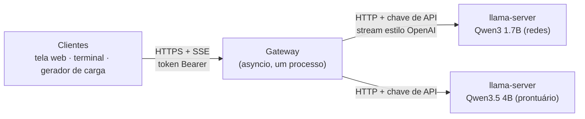

# Relatório — Gateway distribuído de LLMs abertos

Trabalho 2 de Redes de Computadores (INF16158) · UFES · Daniel, Lívia e Eduardo · entrega em 22/11/2026.

Este relatório explica as **principais escolhas de implementação**, como pedem as instruções de entrega. O código
explicado arquivo por arquivo está em [EXPLICACAO.md](../EXPLICACAO.md), e as decisões com as alternativas avaliadas
estão em [PLANO.md](PLANO.md).

## 1. O problema

Um serviço de IA, visto pela rede, é um problema de **filas, roteamento e transporte**. Muitos clientes disputam
poucos processos caros (os modelos), as respostas chegam aos poucos e um nó pode cair no meio. O trabalho implementa o
Projeto 1 da spec: um gateway que recebe pedidos, enfileira por nó, escolhe o nó e devolve a resposta token a token,
com modelos de pesos abertos rodando localmente.

## 2. Arquitetura

São três repositórios: **Backend** (gateway, cliente de terminal, experimentos, `lab.py`), **LLM** (nós) e
**Frontend** (tela). O gateway é o único que decide fila, nó, retry e segurança. Os nós só geram texto.

## 3. Principais escolhas

| Escolha | Alternativas | Por quê |
|---|---|---|
| **Cliente-servidor com gateway central** | P2P | O modelo fica em poucos nós pesados; o gateway concentra autenticação, fila e métricas |
| **TCP, com SSE sobre HTTPS** | UDP; WebSocket; gRPC | Um token perdido corrompe o texto ou o JSON, então a entrega confiável vale mais que alguns ms. O fluxo é de mão única: o SSE é HTTP comum, atravessa proxy, e o cancelamento é fechar a conexão. O WebSocket daria mão dupla, sem uso aqui |
| **Um event loop (asyncio) num processo** | Uma thread por cliente; um processo por núcleo | O gateway passa o tempo esperando rede (cliente e nó); a inferência roda em outro processo. Um loop atende muitas conexões sem travas entre threads |
| **Fila por nó com K vagas** | Um pedido por vez; todos em paralelo | Mandar tudo junto divide a CPU do nó e piora o TTFT de todos. Um por vez desperdiça o nó quando ele aguenta mais. K vagas e uma fila limitada controlam a espera; acima do limite, 503 em vez de espera sem fim |
| **Posição na fila para o cliente** (`queued`) | Só `keepalive` | Quem espera sabe onde está. É o dado central da pergunta-desafio |
| **FIFO ou curtos primeiro com envelhecimento** | Só FIFO | Necessário para comparar as políticas. O envelhecimento impede que um pedido longo espere para sempre |
| **Três políticas de balanceamento** | — | Round-robin (simples), menor fila e menor espera prevista = (fila + 1) × EWMA do tempo de serviço, com reamostragem do nó esquecido |
| **Failover em três casos** | Retomar a resposta em outro nó | Na fila: migra. Antes do 1º token: refaz em outra réplica. Depois: erro parcial explícito, sem concatenar respostas, porque continuar não funciona com JSON forçado e não dá para verificar |
| **JSON do prontuário restrito por schema** | Pedir JSON no prompt | O `llama-server` gera restrito ao JSON Schema, e o gateway valida de novo com Pydantic antes de liberar o `result` |
| **Segurança em camadas** | — | TLS e token no gateway (o caminho do usuário); autorização por domínio; limite de taxa por usuário (token bucket); chave de API entre gateway e nós, para que ninguém use o nosso nó na rede do laboratório |
| **`lab.py` num comando** | Docker Compose; Nix | As máquinas do laboratório não têm Docker garantido nem Nix. O `lab.py` só precisa de Python 3.8+ e fixa binário e modelos por SHA-256: todas as máquinas rodam a mesma coisa |

## 4. Tratamento de erros

| Situação | O que o sistema faz |
|---|---|
| Corpo inválido, grande demais ou lento | 422 / 413 / 408 antes de entrar na fila |
| Sem token, token errado, domínio proibido, acima da taxa | 401 / 401 / 403 / 429 com `Retry-After` |
| Fila cheia ou nenhum nó saudável | 503 com `Retry-After` |
| Cliente desconecta (na fila ou gerando) | O pedido é cancelado e a vaga liberada |
| Cliente desconecta no instante em que ganha a vaga | Um callback libera a vaga (bug achado no ensaio, com teste de regressão) |
| Cliente lento demais para ler | `client_too_slow`, para que um cliente não prenda a vaga |
| Nó cai | Fila migra; refaz antes do 1º token; erro parcial depois; o nó sai da rotação até o `/health` voltar |
| Nó manda protocolo inválido | `backend_protocol_error`: sem `[DONE]`, dados depois do fim, `finish_reason` inválido |
| JSON do prontuário inválido ou cortado | `schema_invalid` / `truncated`, sem `result` |
| Prazo total do pedido | `deadline_exceeded`, na fila ou gerando |

Todo pedido termina com **exatamente um** evento terminal (`done` ou `error`), e o cliente web rejeita qualquer
sequência fora do contrato.

## 5. Testes de desempenho e estabilidade

**Estabilidade.** São 145 testes automatizados (fila, SSE, cancelamento, failover, segurança, protocolo do nó,
ferramentas do experimento) e 15 do cliente web, rodando no CI a cada push.

**Desempenho: método.**
- N = 1, 2, 4, 8, 16 clientes em **laço fechado** (cada um manda o próximo pedido assim que recebe o `done`).
- `max_output_tokens` fixo e temperatura 0, para que todos os pedidos tenham o mesmo tamanho.
- K = 1 e K = 2 vagas por nó, 3 repetições, IC 95%.
- A primeira leva de N pedidos é descartada, porque está fora do regime estável.

**Previsão, gravada antes de medir.** Pela lei de Little, com N clientes e K vagas, para N > K o
**TTFT ≈ (N/K − 1)·S + T0**: o TTFT dispara em N = K e passa a crescer em linha reta, e a vazão agregada fica plana.
*T0* e *S* vêm de uma calibração com N = K.

**Validação do método (ensaio simulado, 09/11).** Antes de usar o modelo real, o pipeline inteiro rodou no Ubuntu com
um nó simulado (~30 trechos/s, 32 trechos por pedido). Isso não é resultado do trabalho: serve para mostrar que as
ferramentas medem o que dizem medir.

| K | N | TTFT medido (s) | TTFT previsto (s) |
|---|---|---|---|
| 1 | 2 | 1,26 ± 0,01 | 1,33 |
| 1 | 8 | 7,50 ± 0,25 | 7,85 |
| 1 | 16 | 15,74 ± 0,65 | 16,54 |
| 2 | 8 | 3,32 ± 0,07 | 3,56 |
| 2 | 16 | 7,53 ± 0,65 | 7,94 |

O ensaio achou dois problemas, que estragariam a medição real:

1. **Uma vaga podia ficar presa para sempre** quando o cliente desconectava no instante em que o pedido ganhava a
   vaga. Foi corrigido e tem teste.
2. **Execuções curtas tinham viés de sobrevivência:** só concluíam os pedidos que esperaram pouco. Com N = 16, o
   TTFT medido dava 6 s contra 16 s previstos. A correção é descartar a primeira leva.

**Medição no laboratório (19/11), com o Qwen3 1.7B (Q4_K_M, só CPU).**
- **Rede:** gateway e tela no PC-A (grad215, 192.168.112.166). Nó `llama-server` no PC-B (grad214,
  192.168.112.169:8101), com uma vaga (K = 1).
- **Prova da distribuição:** o log do `llama-server` no PC-B registrou cada pedido enviado pela tela do PC-A.
- **Vídeo:** a sessão foi gravada em vídeo, como reserva para a apresentação.

| Pedido | Prompt processado | Geração | Total no nó |
|---|---|---|---|
| 1º | 109 tokens em 0,97 s (112 tokens/s) | 120 tokens em 7,68 s (**15,5 tokens/s**) | 8,65 s |
| 2º | 20 tokens novos em 0,25 s (cache de prefixo) | 249 tokens em 17,29 s (**14,4 tokens/s**) | 17,53 s |

**Fila com três clientes (vídeo).** Três abas mandaram um prontuário cada, ao mesmo tempo, para o nó de uma vaga:
- A tela mostrou a posição ao vivo ("Posição na fila do nó redes-1: 2º").
- O primeiro cliente recebeu os tokens em streaming enquanto os outros esperavam, e os demais foram atendidos em
  ordem.

O painel do terceiro cliente registrou:

| Métrica | Valor |
|---|---|
| TTFT (navegador) | **54,3 s** |
| Latência fim a fim | 73,3 s |
| Tokens gerados | 231 |
| Velocidade de geração | 12,2 tokens/s |
| Fim | completa |

**O que os números mostram.**
- **A previsão se confirma na prática.** A geração do terceiro pedido levou 73,3 − 54,3 ≈ 19 s. O TTFT de 54 s
  equivale a dois atendimentos inteiros à frente dele, como prevê TTFT ≈ (N/K − 1)·S + T0 com N = 3 e K = 1. Isso dá
  S ≈ 26 s por prontuário: ~19 s de geração mais o processamento do prompt longo. Com uma vaga, cada cliente a mais na
  fila custa um atendimento inteiro de espera.
- **O cache de prefixo do `llama-server` funciona.** No segundo pedido, o nó reaproveitou o prompt em comum com o
  primeiro, processou só 20 tokens novos e baixou o tempo de prompt de 0,97 s para 0,25 s.
- **A geração por pedido é estável.** Ficou entre 12 e 15,5 tokens/s nos três registros, sozinho ou com fila.

## 6. Pergunta-desafio: TTFT ou tokens/s?

Uma pessoa lê de 4 a 7 tokens/s (200 a 300 palavras por minuto). Se a geração de cada pedido ficar acima disso, mais
tokens/s não muda o que o usuário sente: o que ele sente é o TTFT, a espera até a primeira palavra.

No ensaio simulado com N = 8 e metade dos pedidos curtos, "curtos primeiro" baixou o TTFT médio de 10,5 s para 5,4 s,
mas o p95 subiu de 11,0 s para 17,3 s: os pedidos longos pagaram pela espera menor dos curtos. É a troca esperada: a
política melhora a média e a experiência de quem pede pouco, à custa da cauda.

**No laboratório.**
- **Dados:** a geração ficou entre 12 e 15,5 tokens/s por pedido, de 2 a 3 vezes a velocidade de leitura, mesmo com
  fila. Já o terceiro cliente esperou 54 s pela primeira palavra e depois leu a resposta inteira em 19 s.
- **Resposta:** para o usuário, o que pesa é o **TTFT**. Mais tokens/s quase não mudaria a experiência; o que muda é
  reduzir a espera na fila.
- **Como reduzir a espera:**
  - mais vagas ou réplicas, o que divide N/K;
  - balanceamento por menor latência entre os nós;
  - "curtos primeiro", para quem pede pouco.

## 7. Limitações

- Um processo de gateway: reiniciar descarta filas e limites de taxa.
- Depois do primeiro token, a falha do nó é erro parcial, não continuação.
- Só CPU: o modelo maior leva ~1 minuto por prontuário.
- O roteador semântico é um piloto com 120 frases sintéticas e fica desligado por padrão.
- A extração de prontuário não teve avaliação sistemática de qualidade, e validar o JSON não garante fidelidade. No
  teste real com o modelo pequeno (10/11), o JSON veio válido, mas com campos trocados (temperatura no lugar da
  pressão, frequência no lugar da via) e `alergias: null` para "nega alergias". Por isso o prontuário usa o modelo
  maior por padrão.
