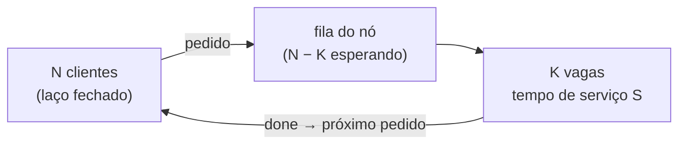

# Experimentos

Ferramentas para o **experimento obrigatório** (TTFT e vazão contra N clientes, com previsão feita antes) e para a
**pergunta-desafio** (FIFO contra curtos primeiro com o sistema saturado). O jeito normal de rodar é pelo `lab.py`:

```bash
python3 lab.py experimento --desafio              # medição real (horas na CPU)
python3 lab.py experimento --simulado --reps 2    # ensaio sem modelo (minutos); NÃO é resultado
```

## As peças

| Arquivo | Papel |
|---|---|
| `carga.py` | N clientes em **laço fechado**: cada um manda um pedido, espera o `done` e manda o próximo. Uma linha de CSV por pedido |
| `previsao.py` | Calibra com N = K e grava a previsão (`previsao-k*.json`) **antes** de medir |
| `graficos.py` | Lê os CSVs e gera os gráficos e o `resumo.md` |
| `perguntas.txt` | 20 perguntas longas: com `max_output_tokens` fixo, todos os pedidos têm o mesmo tamanho |
| `resultados/<data>/` | Uma pasta por rodada. Ensaios simulados (`*_simulado/`) ficam fora do git |

## O modelo de fila (a previsão)



- **Calibração** (N = K, sem fila): *T0* = TTFT médio; *S* = tempo médio de um pedido.
- **Vazão máxima:** X = K/S pedidos por segundo.
- **Lei de Little:** R = N/X = N·S/K.
- **TTFT previsto:** para N > K, quem chega espera R − S na fila, logo **TTFT ≈ (N/K − 1)·S + T0**. Para N ≤ K,
  TTFT ≈ T0.
- **Joelho:** em N\* = K o TTFT "dispara" e passa a crescer em linha reta. Os tokens/s agregados param de crescer.

**Ressalva para K > 1 no modelo real:** as K gerações dividem a mesma CPU, então o *S* medido com N = K já embute essa
disputa. É por isso que a calibração é feita com N = K, e não com N = 1. No backend simulado, as vagas não disputam CPU;
por isso o ensaio simulado com K = 2 não é comparável ao real.

## O que cada CSV tem

Colunas extras da execução: `clientes`, `duracao_s`, `k`, `politica`, `rep`. Por pedido:

| Coluna | Significado |
|---|---|
| `classe` | `unica`, `curta` ou `longa` (só no desafio) |
| `status` / `erro` | `ok`, ou o código do erro |
| `finish_reason` | `stop`, ou `length` (cortada no limite, o esperado aqui) |
| `primeira_posicao` | Posição informada no primeiro `queued` |
| `ttft_ms` | Do envio até o primeiro `delta`, medido no cliente, incluindo a espera na fila |
| `e2e_ms` | Do envio até o `done` |
| `tokens` | `done.completion_tokens`, a contagem do runtime |
| `trechos` | Quantos `delta` chegaram (não são tokens) |
| `inicio_s` | Instante do envio, relativo ao começo da execução |

## Resultados

| Rodada | Tipo | Pasta |
|---|---|---|
| 09/11/2026 | **Ensaio simulado** (Ubuntu 24.04, WSL): valida as ferramentas; não é resultado | não versionada |
| _a fazer_ | Medição real no laboratório | `resultados/<data>/` |

Ao terminar a medição real, faça o commit da pasta inteira: CSVs, `previsao-k*.json`, `resumo.md`, os PNGs e o
`LEIA-ME.txt`, que registra o comando usado.
